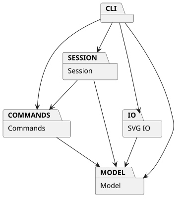
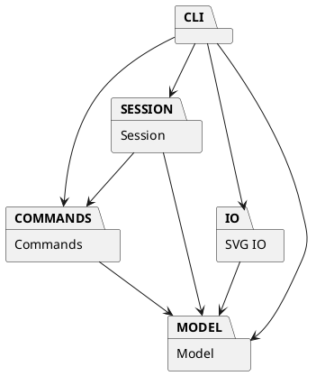

# Lab1 Phase 1：SVG 编辑器（CLI）实验文档

**Git 仓库地址：** https://github.com/pulito1016/svg-editor-lab1

## 架构方案

### 模块划分

| 模块 | 目录 | 职责 |
|---|---|---|
| CLI | `src/cli/` | REPL、带引号的参数解析、命令名分发、统一错误输出 |
| 会话 | `src/session/` | 当前文档、原文件路径、IO 后锁定历史 |
| 命令 | `src/commands/` | Command 对象执行、撤销、重做；一次编辑命令对应一个历史单元 |
| SVG IO | `src/io/` | SVG XML 解析、缺失 id 分配、序列化与转义 |
| 模型 | `src/model/` | 图形类层次、多态几何操作、Composite 容器、文档不变量 |

图的 PlantUML 源文件见 [architecture.puml](architecture.puml)。

各形状一类一文件，`Shape` 封装公共属性和行为，`Rect`、`Circle`、`Ellipse`、`Line`、`Text` 分别实现几何操作；`Group` 保存子节点并递归执行移动、缩放。属性映射是私有的，形状通过 `set` 校验可编辑属性，并通过多态方法提供行为，避免外部对类型逐一分支处理。

### 设计模式的选择与落地

**Command（必选）**：`EditCommand` 封装一次编辑操作、执行前后的 `SvgDocument` 快照和执行结果。`History` 维护 undo/redo 栈。命令先对文档副本操作，全部成功后才替换会话文档，因此 `group` 等多节点操作失败也不会造成部分修改。撤销恢复前快照，重做恢复后快照；撤销后执行新编辑会清空 redo 栈。快照方案以简单、可靠的原子性换取内存开销，适合本阶段的小型图。

**Composite**：`Group` 与叶子都继承 `Shape`；`move`、`scale`、`set`、`delete` 均按 id 定位同一个抽象类型。容器递归操作子图形，删除/移动容器即操作整棵子树。创建时可通过 `in` 指定父容器；`group` 和 `addto` 处理已存在图形。

**简单工厂**：`ShapeFactory` 集中负责类型名、参数到图形实例的映射。当前使用 `switch(type)`，是本阶段允许的两处按名字分派之一；未来插件化可改成 `ShapeProvider` 注册表。另一处命令名分派位于 `Cli` 的 handler 映射；新增命令仍须修改 CLI，未来可改成命令注册接口。这两处均标为待重构项，内核没有其它 `switch(tag)`。

### 依赖方向规则

1. `model` 不依赖 `cli`、`session`、`commands`、`io`；它只表达图形与文档规则。
2. `commands` 仅依赖 `model`，通过 `DocumentState` 接口访问当前文档，不依赖具体会话类。
3. `io` 仅依赖 `model`；文件读写留在 CLI，编解码器只处理 XML 字符串与文档对象。
4. `session` 可依赖 `model` 和 `commands`，负责生命周期与历史边界。
5. `cli` 可依赖以上所有模块，负责把用户输入接到应用操作。

这样模型可在未来由图形界面或 agent 通道复用，XML 解析器和控制台输入不会渗入核心图形类。

### 变化点假设

| 可能变化 | 当前预留或取舍 |
|---|---|
| 新图形类型、复合 `box` | 形状基类已有多态接口，类型创建集中在 `ShapeFactory`；本阶段未做插件注册、子部件传播及 `data-kind` 恢复。未来需要引入 `ShapeProvider`，不能声称“零内核修改”已经实现。 |
| 新命令或 GUI/agent 输入 | 核心模型不依赖 CLI；目前命令路由集中在 `Cli`，后续可迁移到独立控制器或注册机制。 |
| SVG 更多元素和属性 | `SvgCodec` 是唯一 XML 边界；本阶段只支持六种图形与给定属性，未预先搭建完整 SVG 标准抽象。 |
| 大文档的撤销成本 | 整文档快照易验证且原子；若图形量变大，可把 Command 改成局部逆操作或结构共享。 |

## 过程记录

1. 先从说明文档提取不可退让的行为：六种内置图形、按 id 寻址、嵌套容器、编辑命令可撤销、IO 后历史锁定；将 `box` 判定为后续插件阶段，避免把未来目标错误纳入本阶段。
2. 初版命令层曾直接引用具体 `DocumentSession` 类型，形成逆向依赖。检查模块规则后改为 `DocumentState` 小接口，命令只需读取与替换文档。
3. XML 库当前版本的错误处理选项为 `onError` 函数，而不是对象形式的旧 `errorHandler`。编译器报错后核对本地类型声明并修正；随后完成编译。
4. 以流程图示例和集成测试核对关键语义：容器移动时子节点同移；撤销与重做恢复位置；保存后撤销被禁止；保存再读回保留层级和文字转义。
5. 以失败操作检查原子性：非法缩放、缺失 id、重复 id、非法属性不会改变当前树；失败编辑不会意外清除已有 redo。

## 一致性自查

### 模块划分

实现目录与上面的五个模块一致，未发生目录级偏离。测试和示例分别在 `test/`、`examples/`，属于支撑文件，不是运行时模块。当前无需另记修订记录。

### 依赖方向

抽样检查：`Shape.ts`、`Group.ts` 仅引用模型类型；`SvgCodec.ts` 引用模型；`EditCommand.ts` 引用模型和命令层接口；`DocumentSession.ts` 引用模型与历史；`Cli.ts` 作为外层整合。编译通过；未发现违反上述依赖规则的运行时导入。未来增加功能时应继续检查。

## 质量保证手段

- `pnpm build`：TypeScript 严格模式编译通过。
- `pnpm test`：7 个集成测试通过，覆盖六类图形、嵌套容器、group/ungroup、z-order、撤销/重做与 redo 清空、画布和 IO 历史边界、读写往返与 XML 转义、自动补 id、重复 id、非法参数、失败原子性和循环保护。
- `examples/flowchart.cli`：按作业中的两节点流程图顺序回放，可在浏览器中预览生成的 `examples/flowchart.svg`。
- 限制：尚未实现后续阶段的 `box` 插件。读入面向本阶段六种内置图形，不保证任意 SVG 标准文件的全量保真。
